# NL2SQL Enrichment Benchmark — Results

**SQL model:** `claude-haiku-4-5-20251001` (temperature=0, deterministic) | **Judge:** `claude-sonnet-4-6`  
**Questions:** 24 | **Conditions:** `baseline` vs `enriched` | **Context sizes:** baseline=640 chars vs enriched=17,846 chars  
**Last run:** 2026-08-02

> Re-generate: `python3 examples/benchmarks/enrichment_benchmark.py --judge --model claude-haiku-4-5-20251001 --report`

---

## Overall results

| Metric | baseline | enriched | Δ |
|--------|----------|--------|---|
| SQL runs without error | 21/24 (88%) | 23/24 (96%) | +8pp |
| SQL returns non-empty result | 14/24 (58%) | 22/24 (92%) | **+33pp** |
| Semantically **correct** | 4/24 (17%) | 17/24 (71%) | **+54pp** |
| Semantically partial | 5/24 (21%) | 3/24 (12%) | -8pp |
| Semantically incorrect | 15/24 (63%) | 4/24 (17%) | -46pp |

```
Semantic correctness (% of 24 questions judged fully correct)

  baseline   ███░░░░░░░░░░░░   17%  (4/24)
  enriched  ██████████████░   71%  (17/24)
```

---

## Semantic correctness by category

```mermaid
xychart-beta
    title "Semantic Correctness by Category (%)"
    x-axis ["opaque(3)", "time(2)", "quant(3)", "distrib(3)", "none(4)", "enum(6)", "state(3)"]
    y-axis "% semantically correct" 0 --> 100
    bar [0, 0, 33, 0, 50, 0, 33]
    bar [100, 100, 100, 67, 100, 33, 33]
```



*First bar = baseline · Second bar = enriched — sorted by improvement*

| Category | n | Baseline | Enriched | Δ |
|---|---|---|---|---|
| opaque_column | 3 | 0/3 (0%) | 3/3 (100%) | +100pp ★ |
| time_grain | 2 | 0/2 (0%) | 2/2 (100%) | +100pp ★ |
| quantitative_misinterpretation | 3 | 1/3 (33%) | 3/3 (100%) | +67pp ★ |
| distributional | 3 | 0/3 (0%) | 2/3 (67%) | +67pp ↑ |
| none | 4 | 2/4 (50%) | 4/4 (100%) | +50pp |
| enum_coded_value | 6 | 0/6 (0%) | 2/6 (33%) | +33pp ↑ |
| current_state | 3 | 1/3 (33%) | 1/3 (33%) | 0pp |

---

## SQL execution by category (% returning non-empty result)

```mermaid
xychart-beta
    title "SQL Execution: % Questions Returning Rows"
    x-axis ["enum(6)", "time(2)", "quant(3)", "none(4)", "distrib(3)", "opaque(3)", "state(3)"]
    y-axis "% returning rows" 0 --> 100
    bar [33, 0, 67, 100, 33, 100, 67]
    bar [100, 100, 100, 100, 67, 100, 67]
```



| Category | n | Baseline rows | Enriched rows | Δ |
|---|---|---|---|---|
| enum_coded_value | 6 | 2/6 (33%) | 6/6 (100%) | **+67pp** |
| time_grain | 2 | 0/2 (0%) | 2/2 (100%) | **+100pp** |
| quantitative_misinterpretation | 3 | 2/3 (67%) | 3/3 (100%) | +33pp |
| none | 4 | 4/4 (100%) | 4/4 (100%) | 0pp |
| distributional | 3 | 1/3 (33%) | 2/3 (67%) | +33pp |
| opaque_column | 3 | 3/3 (100%) | 3/3 (100%) | 0pp |
| current_state | 3 | 2/3 (67%) | 2/3 (67%) | 0pp |

> **Note on `enum_coded_value`:** The SQL execution story (33% → 100%) is more diagnostic than
> the semantic score (0% → 33%). All 6 questions return 0 rows at baseline because Haiku uses
> English filter values (`WHERE k_symbol='INSURANCE'`) that don't exist in the Czech database.
> blue-data enrichment injects the actual codes → rows returned for all 6. The semantic judge is strict about
> minor query structure issues on top of the correct filter.

---

## Per-question results

Exec: **✅ OK** = ran + returned rows · **⬜ exec** = ran + 0 rows · **❌ FAIL** = SQL error  
Semantic: **✅ cor** = correct · **🟡 par** = partial · **❌ inc** = incorrect

| ID | Category | Question | baseline exec | baseline semantic | enriched exec | enriched semantic |
|---|---|---|---|---|---|---|
| sem_c_001 | none | Which accounts have the highest number of transactions? | ✅ OK | 🟡 par | ✅ OK | ✅ cor |
| sem_c_002 | none | Which loans are the most expensive? | ✅ OK | ✅ cor | ✅ OK | ✅ cor |
| sem_c_003 | none | How many clients are registered in each district? | ✅ OK | 🟡 par | ✅ OK | ✅ cor |
| sem_c_004 | none | What is the average loan amount for each loan status? | ✅ OK | ✅ cor | ✅ OK | ✅ cor |
| sem_e_001 | enum_coded_value | How many cash deposit transactions are in the database? | ✅ OK | ❌ inc | ✅ OK | 🟡 par |
| sem_e_002 | enum_coded_value | Which accounts made outgoing wire transfers in 1998? | ⬜ exec | ❌ inc | ✅ OK | ✅ cor |
| sem_e_003 | enum_coded_value | Find all insurance premium payment transactions | ⬜ exec | ❌ inc | ✅ OK | ✅ cor |
| sem_e_004 | enum_coded_value | Find all pension or retirement income transactions | ⬜ exec | ❌ inc | ✅ OK | 🟡 par |
| sem_e_005 | enum_coded_value | Find all household utility bill payment transactions | ⬜ exec | ❌ inc | ✅ OK | ❌ inc |
| sem_e_006 | enum_coded_value | Count the total number of interest credit transactions | ✅ OK | ❌ inc | ✅ OK | 🟡 par |
| sem_o_001 | opaque_column | Find all districts located in the Prague region | ✅ OK | 🟡 par | ✅ OK | ✅ cor |
| sem_o_002 | opaque_column | What region does the district 'Benesov' belong to? | ✅ OK | ❌ inc | ✅ OK | ✅ cor |
| sem_o_003 | opaque_column | How many districts are there in each region? | ✅ OK | ❌ inc | ✅ OK | ✅ cor |
| sem_s_002 | current_state | How many accounts currently have a negative balance? | ✅ OK | ❌ inc | ✅ OK | ❌ inc |
| sem_s_003 | current_state | Which accounts recovered from a negative balance? | ❌ FAIL | 🟡 par | ⬜ exec | ❌ inc |
| sem_s_004 | current_state | Show monthly total transaction amount for all accounts in 1996 | ✅ OK | ✅ cor | ✅ OK | ✅ cor |
| sem_d_001 | distributional | Find transactions with exceptionally large amounts | ❌ FAIL | 🟡 par | ✅ OK | ✅ cor |
| sem_d_002 | distributional | Find accounts that ever had a balance in the low extreme range | ✅ OK | ❌ inc | ✅ OK | ✅ cor |
| sem_d_003 | distributional | Which accounts currently have a critically low balance? | ✅ OK | ❌ inc | ✅ OK | ✅ cor |
| sem_q_001 | quantitative_misinterpretation | What is the total insurance payment amount per account? | ⬜ exec | ❌ inc | ✅ OK | ✅ cor |
| sem_q_002 | quantitative_misinterpretation | Which accounts have more outgoing than incoming transactions? | ✅ OK | ✅ cor | ✅ OK | ✅ cor |
| sem_q_003 | quantitative_misinterpretation | Which account has the highest net credit balance? | ✅ OK | ❌ inc | ✅ OK | ✅ cor |
| sem_t_001 | time_grain | Show the total deposit amount per month in 1996 | ⬜ exec | ❌ inc | ✅ OK | ✅ cor |
| sem_t_002 | time_grain | Count the number of debit transactions per month in 1995 | ⬜ exec | ❌ inc | ✅ OK | ✅ cor |

---

## What each category tests

### none
**Control.** Questions answerable from column names alone. Both conditions expected correct. Validates that the benchmark does not give an unfair advantage — enrichment should not be needed here.

### enum_coded_value
**ENUM code injection.** Columns store Czech domain codes that an LLM cannot infer from English intent:

| Column | Codes injected by enrichment |
|---|---|
| `trans.operation` | `VKLAD` (cash deposit), `VYBER` (withdrawal), `PREVOD NA UCET` (outgoing wire), `PREVOD Z UCTU` (incoming wire) |
| `trans.k_symbol` | `POJISTNE` (insurance), `DUCHOD` (pension), `SIPO` (utility bills), `UROK` (interest), `SLUZBY` (services) |
| `trans.type` | `PRIJEM` (credit/incoming), `VYDAJ` (debit/outgoing) |

At baseline, Haiku generates English filter values (`WHERE k_symbol='INSURANCE'`) → 0 rows.  
With enrichment, actual codes are in context → queries return correct rows.

### opaque_column
**Opaque column disambiguation.** The `district` table has 16 columns named `a1`–`a16` with no semantic meaning in their names. blue-data enrichment injects statistical sample values that reveal each column's domain:

- `a3` → `ENUM_CATEGORY | values=[Prague, central Bohemia, south Bohemia]` — the region column
- `a2` → `STRING | samples=['Hl.m. Praha', 'Benesov', 'Beroun', ...]` — the district name column

At baseline, Haiku cannot distinguish `a2` from `a3` and often filters or groups by the wrong one.

### current_state
**Process semantics / STATE_VARIABLE.** `trans.balance` is a running total — each row records the account balance *after* that transaction. Asking "what is the current balance?" requires the most recent row per account, not `AVG(balance)` or `MAX(balance)`.

blue-data enrichment annotates:
- `balance` → `process_role=STATE_VARIABLE`
- `latest_record_only: {order_by: 'date', partition_by: ['account_id']}`
- `trans` → `row_semantics=EVENT, event_time=date, entity_keys=['account_id']`

**Note:** This category shows no improvement in the current run. The `latest_record_only` constraint is present in the enriched context, but Haiku does not reliably translate it into a window function or correlated subquery. This is an enriched+L2 use case — explicit column descriptions would make the requirement unambiguous.

### distributional
**Statistical extreme regions.** blue-data enrichment computes per-column `value_axis` extreme cutoffs from the actual data distribution:

- `trans.amount` → `extremes={'small': '< 1320', 'large': '> 21200'}` — statistically derived outlier threshold
- `trans.balance` → `extremes={'small': '< 9500', 'large': '> 32096'}` — critically low / unusually high balance

At baseline, Haiku picks arbitrary round-number thresholds (`> 10000`, `< 0`) with no statistical basis. With enrichment, the data-derived cutoffs are available in context.

### quantitative_misinterpretation
**Ratio and net-credit queries.** Requires correctly isolating debit (`type='VYDAJ'`) vs credit (`type='PRIJEM'`) transactions before computing proportions or net values. At baseline, English type labels return 0 rows → the numerator and denominator of the formula are both empty → the computation is impossible regardless of the formula's correctness.

### time_grain
**Temporal bucketing combined with ENUM filtering.** Monthly aggregations restricted to a specific transaction type. blue-data enrichment provides:
- `type` → `ENUM_CATEGORY | values=[PRIJEM, VYDAJ]` — correct filter value
- `date` → `time_grains=['monthly']` — correct temporal bucket
- `AGGREGATE_OVER_TIME` operator — reinforces time-series aggregation pattern

At baseline, Haiku fails on both simultaneously: wrong type code → 0 matching rows → no monthly groups to aggregate.

---

## Benchmark questions (all 24)

| ID | Category | Enrichment features tested | Question |
|---|---|---|---|
| sem_c_001 | none | — | Which accounts have the highest number of transactions? |
| sem_c_002 | none | — | Which loans are the most expensive? |
| sem_c_003 | none | — | How many clients are registered in each district? |
| sem_c_004 | none | — | What is the average loan amount for each loan status? |
| sem_e_001 | enum_coded_value | `trans.operation` ENUM: VKLAD | How many cash deposit transactions are in the database? |
| sem_e_002 | enum_coded_value | `trans.operation` ENUM: PREVOD NA UCET | Which accounts made outgoing wire transfers to external bank accounts in 1998? |
| sem_e_003 | enum_coded_value | `trans.k_symbol` samples: POJISTNE | Find all transactions that represent insurance premium payments |
| sem_e_004 | enum_coded_value | `trans.k_symbol` samples: DUCHOD | Find all transactions that represent pension or retirement income |
| sem_e_005 | enum_coded_value | `trans.k_symbol` samples: SIPO | Find all transactions that are household utility bill payments |
| sem_e_006 | enum_coded_value | `trans.k_symbol` samples: UROK | Count the total number of interest credit transactions |
| sem_o_001 | opaque_column | `district.a3` ENUM values | Find all districts located in the Prague region |
| sem_o_002 | opaque_column | `district.a2` samples, `district.a3` ENUM | What region does the district 'Benesov' belong to? |
| sem_o_003 | opaque_column | `district.a3` ENUM values | How many districts are there in each region? |
| sem_s_002 | current_state | `trans.balance` STATE_VARIABLE, `latest_record_only` | How many accounts currently have a negative balance? |
| sem_s_003 | current_state | `trans` EVENT, CHANGE_DETECTION operator | Which accounts recovered from a negative balance? |
| sem_s_004 | current_state | `trans.date` EVENT_TIME, AGGREGATE_OVER_TIME | Show monthly total transaction amount for all accounts in 1996 |
| sem_d_001 | distributional | `trans.amount` value_axis large > 21200 | Find transactions with exceptionally large amounts |
| sem_d_002 | distributional | `trans.balance` value_axis small < 9500 | Find all accounts that have ever had a balance in the low extreme range |
| sem_d_003 | distributional | `trans.balance` STATE_VARIABLE + extremes < 9500 | Which accounts currently have a critically low balance? |
| sem_q_001 | quantitative_misinterpretation | `trans.k_symbol` POJISTNE + `trans.amount` can_sum | What is the total insurance payment amount charged to each account? |
| sem_q_002 | quantitative_misinterpretation | `trans.type` ENUM: VYDAJ/PRIJEM | Which accounts have a higher proportion of outgoing than incoming transactions? |
| sem_q_003 | quantitative_misinterpretation | `trans.type` ENUM: VYDAJ/PRIJEM + `trans.amount` can_sum | Which account has the highest net credit balance (deposits minus withdrawals)? |
| sem_t_001 | time_grain | `trans.type` ENUM: PRIJEM + `trans.date` time_grains monthly | Show the total deposit amount per month in 1996 |
| sem_t_002 | time_grain | `trans.type` ENUM: VYDAJ + `trans.date` time_grains monthly | Count the number of debit transactions per month in 1995 |
