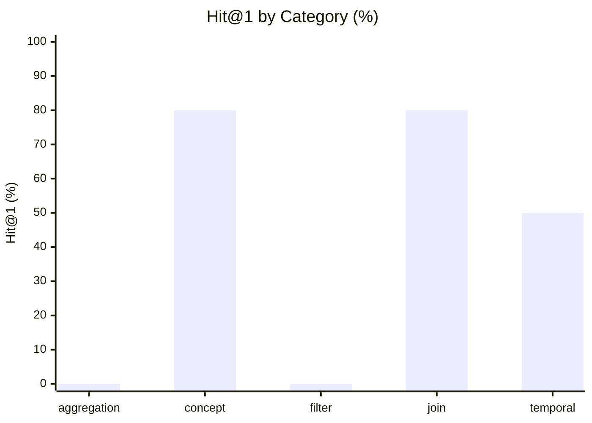

# Finance Data Discovery Benchmark — Results

**Conditions:** `keyword`  
**Queries:** 20 analytical discovery questions  
**Last run:** 2026-08-08 05:33 UTC

---

## Overall retrieval quality

| Metric | keyword |
|--------|---------|
| Hit@1 | 45% |
| Hit@3 | 50% |
| Hit@5 | 80% |
| MRR | 56% |

```
Hit@5 (% of 20 questions with a relevant result in top 5)

  keyword     ████████████░░░   80%
```

---

## Results by category



| Category | n | keyword Hit@1 | keyword MRR |
|---|---|---|---|
| aggregation | 4 | 0% | 0.16 |
| concept | 5 | 80% | 0.87 |
| filter | 4 | 0% | 0.20 |
| join | 5 | 80% | 0.85 |
| temporal | 2 | 50% | 0.60 |

---

## Per-question results

| ID | Category | Intent | keyword H@1 | keyword MRR | keyword Top-3 |
|---|---|--- |---|---|--- |
| fin_disc_01 | filter | How many clients defaulted on their loans? | ❌ | 0.20 | finance, finance, public |
| fin_disc_02 | aggregation | What is the average monthly payment amount for active l… | ❌ | 0.14 | amount, amount, finance |
| fin_disc_03 | join | Which district has the highest average loan amount? | ✅ | 1.00 | loan, district, finance |
| fin_disc_04 | filter | How many transactions were cash withdrawals? | ❌ | 0.14 | finance, finance, public |
| fin_disc_05 | concept | What is the current account balance for each client? | ❌ | 0.33 | account, account, balance |
| fin_disc_06 | aggregation | Which accounts have more than one hundred transactions? | ❌ | 0.25 | finance, finance, public |
| fin_disc_07 | concept | What is the total amount paid as pension income across … | ✅ | 1.00 | amount, amount, finance |
| fin_disc_08 | concept | How old is the youngest client at the bank? | ✅ | 1.00 | client, finance, finance |
| fin_disc_09 | join | Which accounts belong to clients living in the Prague r… | ❌ | 0.25 | finance, finance, public |
| fin_disc_10 | filter | What percentage of loans are fully repaid with no issue… | ❌ | 0.20 | finance, finance, public |
| fin_disc_11 | join | What is the average loan duration in months grouped by … | ✅ | 1.00 | loan, duration, finance |
| fin_disc_12 | aggregation | How many distinct external banks received wire transfer… | ❌ | 0.14 | finance, finance, public |
| fin_disc_13 | temporal | How many loans were issued in each calendar year? | ❌ | 0.20 | finance, finance, public |
| fin_disc_14 | concept | What is the maximum outstanding debt amount currently o… | ✅ | 1.00 | amount, amount, finance |
| fin_disc_15 | filter | Which accounts receive their statements on a monthly ba… | ❌ | 0.25 | finance, finance, public |
| fin_disc_16 | aggregation | How many male versus female clients does the bank have? | ❌ | 0.11 | bank, finance, finance |
| fin_disc_17 | temporal | What is the average transaction amount per calendar mon… | ✅ | 1.00 | amount, amount, finance |
| fin_disc_18 | concept | What is the total amount paid for insurance across all … | ✅ | 1.00 | amount, amount, finance |
| fin_disc_19 | join | Which clients have an account in one district but live … | ✅ | 1.00 | account, district, account |
| fin_disc_20 | join | What is the total loan amount taken out by clients in e… | ✅ | 1.00 | loan, amount, amount |
