# Finance Data Discovery Benchmark — Results

**Conditions:** `keyword`, `keyword_enriched`, `hybrid`, `hybrid_enriched`  
**Queries:** 48 total, 25 enrichment-sensitive  
**Last run:** 2026-08-25 03:57 UTC

> Enrichment = Layer-1 SemanticTypeInferencer (deterministic, no API key).
> ★ marks queries where opaque column names or coded enum values make enrichment helpful.

---

## Overall retrieval quality

| Metric | keyword | keyword_enriched | hybrid | hybrid_enriched |
|--------|---------|---------|---------|---------|
| Hit@1 | 35% | 35% | 42% | 42% |
| Hit@3 | 40% | 40% | 65% | 65% |
| Hit@5 | 73% | 73% | 73% | 73% |
| MRR | 49% | 49% | 56% | 56% |

| Metric | Δ kw → kw_enr | Δ kw → hybrid | Δ kw → hyb_enr |
|--------|---------------|---------------|----------------|
| Hit@1 | **+0.000** | **+0.062** | **+0.062** |
| Hit@3 | **+0.000** | **+0.250** | **+0.250** |
| Hit@5 | **+0.000** | **+0.000** | **+0.000** |
| MRR | **+0.000** | **+0.072** | **+0.072** |

```
Hit@5 (% of 48 queries with a relevant result in top 5)

  keyword               ███████████░░░░   73%
  keyword_enriched      ███████████░░░░   73%
  hybrid                ███████████░░░░   73%
  hybrid_enriched       ███████████░░░░   73%
```

---

## Enrichment-sensitive questions

These 25 questions target opaque column names or coded enum values where enrichment annotations are expected to improve retrieval.

| Metric | keyword | keyword_enriched | hybrid | hybrid_enriched |
|--------|---------|---------|---------|---------|
| Hit@1 | 40% | 40% | 44% | 44% |
| Hit@3 | 40% | 40% | 60% | 60% |
| Hit@5 | 80% | 80% | 64% | 64% |
| MRR | 52% | 52% | 54% | 54% |

---

## Results by category

```mermaid
xychart-beta
    title "Hit@1 by Category (%)"
    x-axis ["aggregation", "attribute", "concept", "enrichment_sensitive", "filter", "join", "schema", "temporal"]
    y-axis "Hit@1 (%)" 0 --> 100
    bar [0, 25, 57, 62, 0, 56, 33, 20]
    bar [0, 25, 57, 62, 0, 56, 33, 20]
    bar [17, 0, 57, 50, 50, 56, 33, 40]
    bar [17, 0, 57, 50, 50, 56, 33, 40]
```



*Bars left-to-right: keyword · keyword_enriched · hybrid · hybrid_enriched*

| Category | n | keyword Hit@1 | keyword MRR | keyword_enriched Hit@1 | keyword_enriched MRR | hybrid Hit@1 | hybrid MRR | hybrid_enriched Hit@1 | hybrid_enriched MRR |
|---|---|---|---|---|---|---|---|---|---|
| aggregation | 6 | 0% | 0.20 | 0% | 0.20 | 17% | 0.45 | 17% | 0.45 |
| attribute | 4 | 25% | 0.36 | 25% | 0.36 | 0% | 0.25 | 0% | 0.25 |
| concept | 7 | 57% | 0.71 | 57% | 0.71 | 57% | 0.73 | 57% | 0.73 |
| enrichment_sensitive | 8 | 62% | 0.69 | 62% | 0.69 | 50% | 0.56 | 50% | 0.56 |
| filter | 6 | 0% | 0.19 | 0% | 0.19 | 50% | 0.52 | 50% | 0.52 |
| join | 9 | 56% | 0.68 | 56% | 0.68 | 56% | 0.74 | 56% | 0.74 |
| schema | 3 | 33% | 0.47 | 33% | 0.47 | 33% | 0.46 | 33% | 0.46 |
| temporal | 5 | 20% | 0.34 | 20% | 0.34 | 40% | 0.52 | 40% | 0.52 |

---

## Per-question results

| ID | Cat | ★ | Intent | keyword H@1 | keyword MRR | keyword Top-3 | keyword_enriched H@1 | keyword_enriched MRR | keyword_enriched Top-3 | hybrid H@1 | hybrid MRR | hybrid Top-3 | hybrid_enriched H@1 | hybrid_enriched MRR | hybrid_enriched Top-3 |
|---|---|---|--- |---|---|--- |---|---|--- |---|---|--- |---|---|--- |
| fin_disc_01 | filter | ★ | How many clients defaulted on their loans? | ❌ | 0.20 | finance, finance, public | ❌ | 0.20 | finance, finance, public | ✅ | 1.00 | loan, loan_id, client | ✅ | 1.00 | loan, loan_id, client |
| fin_disc_02 | aggregation | ★ | What is the average monthly payment amount for act… | ❌ | 0.12 | amount, amount, finance | ❌ | 0.12 | amount, amount, finance | ❌ | 0.25 | amount, amount, loan_id | ❌ | 0.25 | amount, amount, loan_id |
| fin_disc_03 | join |  | Which district has the highest average loan amount… | ✅ | 1.00 | loan, district, finance | ✅ | 1.00 | loan, district, finance | ✅ | 1.00 | loan, district, loan_id | ✅ | 1.00 | loan, district, loan_id |
| fin_disc_04 | filter | ★ | How many transactions were cash withdrawals? | ❌ | 0.25 | finance, finance, public | ❌ | 0.25 | finance, finance, public | ❌ | 0.00 | bank, payments, finance | ❌ | 0.00 | bank, payments, finance |
| fin_disc_05 | concept |  | What is the current account balance for each clien… | ❌ | 0.50 | account, balance, account | ❌ | 0.50 | account, balance, account | ❌ | 0.50 | account, balance, account | ❌ | 0.50 | account, balance, account |
| fin_disc_06 | aggregation |  | Which accounts have more than one hundred transact… | ❌ | 0.25 | finance, finance, public | ❌ | 0.25 | finance, finance, public | ❌ | 0.50 | public, account_id, account_id | ❌ | 0.50 | public, account_id, account_id |
| fin_disc_07 | concept | ★ | What is the total amount paid as pension income ac… | ✅ | 1.00 | amount, amount, finance | ✅ | 1.00 | amount, amount, finance | ✅ | 1.00 | amount, amount, payments | ✅ | 1.00 | amount, amount, payments |
| fin_disc_08 | concept |  | How old is the youngest client at the bank? | ✅ | 1.00 | client, finance, finance | ✅ | 1.00 | client, finance, finance | ✅ | 1.00 | client, bank, client_id | ✅ | 1.00 | client, bank, client_id |
| fin_disc_09 | join | ★ | Which accounts belong to clients living in the Pra… | ❌ | 0.20 | finance, finance, public | ❌ | 0.20 | finance, finance, public | ❌ | 0.14 | client_id, account_id, account_id | ❌ | 0.14 | client_id, account_id, account_id |
| fin_disc_10 | filter | ★ | What percentage of loans are fully repaid with no … | ❌ | 0.17 | finance, finance, public | ❌ | 0.17 | finance, finance, public | ✅ | 1.00 | loan, loan_id, finance | ✅ | 1.00 | loan, loan_id, finance |
| fin_disc_11 | join |  | What is the average loan duration in months groupe… | ✅ | 1.00 | loan, duration, finance | ✅ | 1.00 | loan, duration, finance | ✅ | 1.00 | loan, duration, loan_id | ✅ | 1.00 | loan, duration, loan_id |
| fin_disc_12 | aggregation |  | How many distinct external banks received wire tra… | ❌ | 0.25 | finance, finance, public | ❌ | 0.25 | finance, finance, public | ✅ | 1.00 | bank, finance, finance | ✅ | 1.00 | bank, finance, finance |
| fin_disc_13 | temporal |  | How many loans were issued in each calendar year? | ❌ | 0.17 | finance, finance, public | ❌ | 0.17 | finance, finance, public | ❌ | 0.50 | loan_id, loan, finance | ❌ | 0.50 | loan_id, loan, finance |
| fin_disc_14 | concept |  | What is the maximum outstanding debt amount curren… | ✅ | 1.00 | amount, amount, finance | ✅ | 1.00 | amount, amount, finance | ✅ | 1.00 | amount, amount, loan | ✅ | 1.00 | amount, amount, loan |
| fin_disc_15 | filter | ★ | Which accounts receive their statements on a month… | ❌ | 0.12 | finance, finance, public | ❌ | 0.12 | finance, finance, public | ❌ | 0.11 | payments, bank, finance | ❌ | 0.11 | payments, bank, finance |
| fin_disc_16 | aggregation |  | How many male versus female clients does the bank … | ❌ | 0.17 | bank, finance, finance | ❌ | 0.17 | bank, finance, finance | ❌ | 0.33 | bank, finance, gender | ❌ | 0.33 | bank, finance, gender |
| fin_disc_17 | temporal |  | What is the average transaction amount per calenda… | ✅ | 1.00 | amount, amount, finance | ✅ | 1.00 | amount, amount, finance | ✅ | 1.00 | amount, amount, payments | ✅ | 1.00 | amount, amount, payments |
| fin_disc_18 | concept | ★ | What is the total amount paid for insurance across… | ✅ | 1.00 | amount, amount, finance | ✅ | 1.00 | amount, amount, finance | ✅ | 1.00 | amount, amount, payments | ✅ | 1.00 | amount, amount, payments |
| fin_disc_19 | join |  | Which clients have an account in one district but … | ❌ | 0.50 | district, account, account | ❌ | 0.50 | district, account, account | ❌ | 0.50 | district, account, account | ❌ | 0.50 | district, account, account |
| fin_disc_20 | join | ★ | What is the total loan amount taken out by clients… | ✅ | 1.00 | loan, amount, amount | ✅ | 1.00 | loan, amount, amount | ✅ | 1.00 | loan, amount, amount | ✅ | 1.00 | loan, amount, amount |
| fin_disc_21 | aggregation |  | What is the total number of transaction records in… | ❌ | 0.25 | finance, finance, public | ❌ | 0.25 | finance, finance, public | ❌ | 0.10 | finance, trans_id, public | ❌ | 0.10 | finance, trans_id, public |
| fin_disc_22 | aggregation |  | How many distinct accounts have taken out at least… | ❌ | 0.17 | finance, finance, public | ❌ | 0.17 | finance, finance, public | ❌ | 0.50 | loan_id, loan, public | ❌ | 0.50 | loan_id, loan, public |
| fin_disc_23 | filter | ★ | Which transactions are debits — money leaving the … | ❌ | 0.25 | finance, finance, public | ❌ | 0.25 | finance, finance, public | ❌ | 0.00 | payments, bank, finance | ❌ | 0.00 | payments, bank, finance |
| fin_disc_24 | filter | ★ | Which loans are currently active with no repayment… | ❌ | 0.17 | finance, finance, public | ❌ | 0.17 | finance, finance, public | ✅ | 1.00 | loan, loan_id, bank | ✅ | 1.00 | loan, loan_id, bank |
| fin_disc_25 | temporal |  | How many bank accounts were opened each year? | ❌ | 0.11 | bank, finance, finance | ❌ | 0.11 | bank, finance, finance | ❌ | 0.11 | bank, finance, account_id | ❌ | 0.11 | bank, finance, account_id |
| fin_disc_26 | temporal |  | Which loans were issued most recently? | ❌ | 0.17 | finance, finance, public | ❌ | 0.17 | finance, finance, public | ✅ | 1.00 | loan, loan_id, finance | ✅ | 1.00 | loan, loan_id, finance |
| fin_disc_27 | temporal |  | How many transactions occurred each calendar month… | ❌ | 0.25 | finance, finance, public | ❌ | 0.25 | finance, finance, public | ❌ | 0.00 | payments, finance, public | ❌ | 0.00 | payments, finance, public |
| fin_disc_28 | concept | ★ | Which field in the transaction table indicates mon… | ❌ | 0.25 | finance, finance, public | ❌ | 0.25 | finance, finance, public | ❌ | 0.10 | payments, finance, bank | ❌ | 0.10 | payments, finance, bank |
| fin_disc_29 | concept | ★ | What column stores a client's geographic region? | ❌ | 0.20 | finance, finance, public | ❌ | 0.20 | finance, finance, public | ❌ | 0.50 | client_id, district_id, district_id | ❌ | 0.50 | client_id, district_id, district_id |
| fin_disc_30 | join |  | What is the average loan amount for male versus fe… | ✅ | 1.00 | loan, amount, amount | ✅ | 1.00 | loan, amount, amount | ✅ | 1.00 | loan, amount, amount | ✅ | 1.00 | loan, amount, amount |
| fin_disc_31 | join | ★ | Which district has the most bank accounts opened? | ✅ | 1.00 | district, bank, finance | ✅ | 1.00 | district, bank, finance | ❌ | 0.50 | bank, district, finance | ❌ | 0.50 | bank, district, finance |
| fin_disc_32 | join |  | How many loans are held by female clients? | ❌ | 0.20 | finance, finance, public | ❌ | 0.20 | finance, finance, public | ❌ | 0.50 | loan_id, loan, finance | ❌ | 0.50 | loan_id, loan, finance |
| fin_disc_33 | join | ★ | What is the total inflow transaction volume per ac… | ❌ | 0.25 | finance, finance, public | ❌ | 0.25 | finance, finance, public | ✅ | 1.00 | account_id, account_id, account_id | ✅ | 1.00 | account_id, account_id, account_id |
| fin_disc_34 | schema |  | What data do we store about each bank client? | ❌ | 0.17 | finance, bank, finance | ❌ | 0.17 | finance, bank, finance | ❌ | 0.17 | bank, finance, finance | ❌ | 0.17 | bank, finance, finance |
| fin_disc_35 | schema |  | Which entities in the database represent financial… | ❌ | 0.25 | finance, finance, public | ❌ | 0.25 | finance, finance, public | ❌ | 0.20 | public, finance, account | ❌ | 0.20 | public, finance, account |
| fin_disc_36 | schema |  | What information does a loan record contain? | ✅ | 1.00 | loan, finance, finance | ✅ | 1.00 | loan, finance, finance | ✅ | 1.00 | loan, loan_id, finance | ✅ | 1.00 | loan, loan_id, finance |
| fin_disc_37 | attribute |  | Which column stores the monthly repayment amount f… | ❌ | 0.12 | amount, amount, finance | ❌ | 0.12 | amount, amount, finance | ❌ | 0.25 | amount, amount, loan_id | ❌ | 0.25 | amount, amount, loan_id |
| fin_disc_38 | attribute | ★ | Where is the type of a bank transaction stored? | ✅ | 1.00 | type, bank, finance | ✅ | 1.00 | type, bank, finance | ❌ | 0.50 | bank, type, finance | ❌ | 0.50 | bank, type, finance |
| fin_disc_39 | attribute |  | Which field encodes a client's date of birth? | ❌ | 0.12 | date, date, date | ❌ | 0.12 | date, date, date | ❌ | 0.25 | date, date, date | ❌ | 0.25 | date, date, date |
| fin_disc_40 | attribute | ★ | What attribute stores the purpose code for a bank … | ❌ | 0.20 | bank, finance, finance | ❌ | 0.20 | bank, finance, finance | ❌ | 0.00 | bank, account, payments | ❌ | 0.00 | bank, account, payments |
| fin_disc_41 | enrichment_sensitive | ★ | which column classifies a loan as defaulted, runni… | ✅ | 1.00 | loan, finance, finance | ✅ | 1.00 | loan, finance, finance | ✅ | 1.00 | loan, loan_id, finance | ✅ | 1.00 | loan, loan_id, finance |
| fin_disc_42 | enrichment_sensitive | ★ | find the field that records the coded reason or pu… | ❌ | 0.20 | bank, finance, finance | ❌ | 0.20 | bank, finance, finance | ❌ | 0.00 | bank, payments, finance | ❌ | 0.00 | bank, payments, finance |
| fin_disc_43 | enrichment_sensitive | ★ | which district attribute stores the total number o… | ✅ | 1.00 | district, finance, finance | ✅ | 1.00 | district, finance, finance | ✅ | 1.00 | district, district_id, district_id | ✅ | 1.00 | district, district_id, district_id |
| fin_disc_44 | enrichment_sensitive | ★ | find the district column that records unemployment… | ✅ | 1.00 | district, finance, finance | ✅ | 1.00 | district, finance, finance | ✅ | 1.00 | district, finance, district_id | ✅ | 1.00 | district, finance, district_id |
| fin_disc_45 | enrichment_sensitive | ★ | which column distinguishes card withdrawals from b… | ❌ | 0.20 | bank, finance, finance | ❌ | 0.20 | bank, finance, finance | ❌ | 0.00 | bank, payments, finance | ❌ | 0.00 | bank, payments, finance |
| fin_disc_46 | enrichment_sensitive | ★ | find the field in the district table that stores t… | ✅ | 1.00 | district, finance, finance | ✅ | 1.00 | district, finance, finance | ✅ | 1.00 | district, district_id, district_id | ✅ | 1.00 | district, district_id, district_id |
| fin_disc_47 | enrichment_sensitive | ★ | which column marks whether a bank transaction is i… | ❌ | 0.14 | account, account, bank | ❌ | 0.14 | account, account, bank | ❌ | 0.00 | bank, account, account | ❌ | 0.00 | bank, account, account |
| fin_disc_48 | enrichment_sensitive | ★ | find the attribute that encodes how often the bank… | ✅ | 1.00 | account, account, bank | ✅ | 1.00 | account, account, bank | ❌ | 0.50 | bank, account, account | ❌ | 0.50 | bank, account, account |
