# Finance Data Discovery Benchmark — Results

**Conditions:** `keyword`, `hybrid`  
**Queries:** 80 analytical discovery questions  
**Last run:** 2026-08-25 23:22 UTC

---

## Overall retrieval quality

| Metric | keyword | hybrid |
|--------|---------|---------|
| Hit@1 | 28% | 40% |
| Hit@3 | 34% | 61% |
| Hit@5 | 62% | 69% |
| MRR | 41% | 54% |

| Metric | Δ keyword → hybrid |
|--------|--------------------|
| Hit@1 | **+0.125** (28% → 40%) |
| Hit@3 | **+0.275** (34% → 61%) |
| Hit@5 | **+0.062** (62% → 69%) |
| MRR | **+0.126** (41% → 54%) |

```
Hit@5 (% of 80 questions with a relevant result in top 5)

  keyword     █████████░░░░░░   62%
  hybrid      ██████████░░░░░   69%
```

---

## Results by category

```mermaid
xychart-beta
    title "Hit@1 by Category (%)"
    x-axis ["aggregation", "attribute", "concept", "filter", "join", "schema", "temporal"]
    y-axis "Hit@1 (%)" 0 --> 100
    bar [25, 40, 31, 8, 54, 20, 10]
    bar [67, 30, 31, 42, 54, 30, 20]
```



*First bar = keyword · Second bar = hybrid*

| Category | n | keyword Hit@1 | keyword MRR | hybrid Hit@1 | hybrid MRR |
|---|---|---|---|---|---|
| aggregation | 12 | 25% | 0.41 | 67% | 0.77 |
| attribute | 10 | 40% | 0.46 | 30% | 0.42 |
| concept | 13 | 31% | 0.43 | 31% | 0.47 |
| filter | 12 | 8% | 0.22 | 42% | 0.44 |
| join | 13 | 54% | 0.66 | 54% | 0.74 |
| schema | 10 | 20% | 0.40 | 30% | 0.41 |
| temporal | 10 | 10% | 0.25 | 20% | 0.43 |

---

## Per-question results

| ID | Category | Intent | keyword H@1 | keyword MRR | keyword Top-3 | hybrid H@1 | hybrid MRR | hybrid Top-3 |
|---|---|--- |---|---|--- |---|---|--- |
| fin_disc_01 | filter | How many clients defaulted on their loans? | ❌ | 0.25 | finance, finance, public | ✅ | 1.00 | loan, loan_id, public |
| fin_disc_02 | aggregation | What is the average monthly payment amount for active l… | ❌ | 0.14 | amount, amount, finance | ❌ | 0.25 | amount, amount, loan_id |
| fin_disc_03 | join | Which district has the highest average loan amount? | ✅ | 1.00 | loan, district, finance | ✅ | 1.00 | loan, district, loan_id |
| fin_disc_04 | filter | How many transactions were cash withdrawals? | ❌ | 0.17 | finance, finance, public | ❌ | 0.00 | bank, payments, finance |
| fin_disc_05 | concept | What is the current account balance for each client? | ❌ | 0.50 | account, balance, account | ❌ | 0.50 | account, balance, account |
| fin_disc_06 | aggregation | Which accounts have more than one hundred transactions? | ❌ | 0.17 | finance, finance, public | ✅ | 1.00 | account_id, account_id, account_id |
| fin_disc_07 | concept | What is the total amount paid as pension income across … | ✅ | 1.00 | amount, amount, finance | ✅ | 1.00 | amount, amount, payments |
| fin_disc_08 | concept | How old is the youngest client at the bank? | ✅ | 1.00 | client, finance, finance | ✅ | 1.00 | client, bank, client_id |
| fin_disc_09 | join | Which accounts belong to clients living in the Prague r… | ❌ | 0.25 | finance, finance, public | ❌ | 0.14 | client_id, account_id, account_id |
| fin_disc_10 | filter | What percentage of loans are fully repaid with no issue… | ❌ | 0.20 | finance, finance, public | ✅ | 1.00 | loan, loan_id, finance |
| fin_disc_11 | join | What is the average loan duration in months grouped by … | ✅ | 1.00 | loan, duration, finance | ✅ | 1.00 | loan, duration, loan_id |
| fin_disc_12 | aggregation | How many distinct external banks received wire transfer… | ❌ | 0.17 | finance, finance, public | ✅ | 1.00 | bank, finance, finance |
| fin_disc_13 | temporal | How many loans were issued in each calendar year? | ❌ | 0.20 | finance, finance, public | ❌ | 0.50 | loan_id, loan, finance |
| fin_disc_14 | concept | What is the maximum outstanding debt amount currently o… | ✅ | 1.00 | amount, amount, finance | ✅ | 1.00 | amount, amount, loan |
| fin_disc_15 | filter | Which accounts receive their statements on a monthly ba… | ❌ | 0.12 | finance, finance, public | ❌ | 0.11 | payments, bank, finance |
| fin_disc_16 | aggregation | How many male versus female clients does the bank have? | ❌ | 0.20 | bank, finance, finance | ❌ | 0.33 | bank, finance, gender |
| fin_disc_17 | temporal | What is the average transaction amount per calendar mon… | ✅ | 1.00 | amount, amount, finance | ✅ | 1.00 | amount, amount, payments |
| fin_disc_18 | concept | What is the total amount paid for insurance across all … | ✅ | 1.00 | amount, amount, finance | ✅ | 1.00 | amount, amount, payments |
| fin_disc_19 | join | Which clients have an account in one district but live … | ❌ | 0.50 | district, account, account | ❌ | 0.50 | district, account, account |
| fin_disc_20 | join | What is the total loan amount taken out by clients in e… | ✅ | 1.00 | loan, amount, amount | ✅ | 1.00 | loan, amount, amount |
| fin_disc_21 | aggregation | What is the total number of transaction records in the … | ❌ | 0.17 | finance, finance, public | ❌ | 0.10 | finance, trans_id, account_id |
| fin_disc_22 | aggregation | How many distinct accounts have taken out at least one … | ❌ | 0.20 | finance, finance, public | ❌ | 0.50 | loan_id, loan, public |
| fin_disc_23 | filter | Which transactions are debits — money leaving the accou… | ❌ | 0.17 | finance, finance, public | ❌ | 0.00 | payments, bank, finance |
| fin_disc_24 | filter | Which loans are currently active with no repayment prob… | ❌ | 0.20 | finance, finance, public | ✅ | 1.00 | loan, loan_id, bank |
| fin_disc_25 | temporal | How many bank accounts were opened each year? | ❌ | 0.11 | bank, finance, finance | ❌ | 0.11 | bank, finance, account_id |
| fin_disc_26 | temporal | Which loans were issued most recently? | ❌ | 0.20 | finance, finance, public | ✅ | 1.00 | loan, loan_id, finance |
| fin_disc_27 | temporal | How many transactions occurred each calendar month? | ❌ | 0.17 | finance, finance, public | ❌ | 0.00 | payments, finance, bank |
| fin_disc_28 | concept | Which field in the transaction table indicates money in… | ❌ | 0.17 | finance, finance, public | ❌ | 0.10 | payments, finance, bank |
| fin_disc_29 | concept | What column stores a client's geographic region? | ❌ | 0.25 | finance, finance, public | ❌ | 0.50 | client_id, district_id, district_id |
| fin_disc_30 | join | What is the average loan amount for male versus female … | ✅ | 1.00 | loan, amount, amount | ✅ | 1.00 | loan, amount, amount |
| fin_disc_31 | join | Which district has the most bank accounts opened? | ✅ | 1.00 | district, bank, finance | ❌ | 0.50 | bank, district, finance |
| fin_disc_32 | join | How many loans are held by female clients? | ❌ | 0.25 | finance, finance, public | ❌ | 0.50 | loan_id, loan, finance |
| fin_disc_33 | join | What is the total inflow transaction volume per account… | ❌ | 0.17 | finance, finance, public | ✅ | 1.00 | account_id, account_id, account_id |
| fin_disc_34 | schema | What data do we store about each bank client? | ❌ | 0.20 | finance, bank, finance | ❌ | 0.17 | bank, finance, finance |
| fin_disc_35 | schema | Which entities in the database represent financial tran… | ❌ | 0.20 | finance, finance, public | ❌ | 0.20 | public, finance, account |
| fin_disc_36 | schema | What information does a loan record contain? | ✅ | 1.00 | loan, finance, finance | ✅ | 1.00 | loan, loan_id, finance |
| fin_disc_37 | attribute | Which column stores the monthly repayment amount for a … | ❌ | 0.14 | amount, amount, finance | ❌ | 0.25 | amount, amount, loan_id |
| fin_disc_38 | attribute | Where is the type of a bank transaction stored? | ✅ | 1.00 | type, bank, finance | ❌ | 0.50 | bank, type, finance |
| fin_disc_39 | attribute | Which field encodes a client's date of birth? | ❌ | 0.14 | date, date, date | ❌ | 0.25 | date, date, date |
| fin_disc_40 | attribute | What attribute stores the purpose code for a bank trans… | ❌ | 0.14 | bank, finance, finance | ❌ | 0.00 | bank, account, payments |
| fin_disc_41 | concept | What records the credit card type issued to a bank clie… | ❌ | 0.50 | client, type, bank | ❌ | 0.50 | bank, type, client |
| fin_disc_42 | concept | Which entity represents a recurring payment order set u… | ❌ | 0.00 | client, finance, finance | ❌ | 0.00 | client, payments, account |
| fin_disc_43 | concept | What entity links a client to a bank account — recordin… | ❌ | 0.00 | client, account, account | ❌ | 0.00 | account, bank, client |
| fin_disc_44 | concept | Which attribute stores the coded purpose of a standing … | ❌ | 0.00 | finance, finance, public | ❌ | 0.00 | payments, account, amount |
| fin_disc_45 | concept | What field encodes both a client's birthdate and gender… | ❌ | 0.20 | gender, finance, finance | ❌ | 0.50 | gender, birth_date, client_id |
| fin_disc_46 | concept | Which field stores the destination account number for a… | ❌ | 0.00 | account, account, bank | ❌ | 0.00 | bank, account, account |
| fin_disc_47 | filter | Which accounts are configured to receive bank statement… | ❌ | 0.11 | bank, finance, finance | ❌ | 0.11 | bank, finance, payments |
| fin_disc_48 | filter | Which loans have a repayment term longer than 60 months… | ❌ | 0.20 | finance, finance, public | ✅ | 1.00 | loan, loan_id, duration |
| fin_disc_49 | filter | Which credit cards were issued to junior tier clients? | ❌ | 0.00 | finance, finance, public | ❌ | 0.00 | payments, bank, client_id |
| fin_disc_50 | filter | Which transactions have a purpose code indicating a loa… | ❌ | 0.17 | loan, finance, finance | ❌ | 0.00 | loan, loan_id, payments |
| fin_disc_51 | filter | Which transactions have no recorded operation type? | ✅ | 1.00 | operation, finance, finance | ✅ | 1.00 | operation, public, trans |
| fin_disc_52 | filter | Which standing payment orders involve transfers to an e… | ❌ | 0.00 | finance, finance, public | ❌ | 0.00 | bank, payments, loan |
| fin_disc_53 | aggregation | What is the total number of transactions recorded for e… | ❌ | 0.17 | finance, finance, public | ✅ | 1.00 | account_id, account_id, account_id |
| fin_disc_54 | aggregation | What is the average loan amount across all issued loans… | ✅ | 1.00 | loan, amount, amount | ✅ | 1.00 | loan, amount, amount |
| fin_disc_55 | aggregation | Which district has the highest average salary? | ✅ | 1.00 | district, finance, finance | ✅ | 1.00 | district, district_id, district_id |
| fin_disc_56 | aggregation | How many clients are registered in each district? | ❌ | 0.25 | finance, finance, public | ✅ | 1.00 | district_id, district_id, district_id |
| fin_disc_57 | aggregation | How many transactions of each operation type exist in t… | ❌ | 0.50 | type, operation, finance | ✅ | 1.00 | operation, type, finance |
| fin_disc_58 | aggregation | What is the total loan amount outstanding for loans cur… | ✅ | 1.00 | loan, amount, amount | ✅ | 1.00 | loan, amount, amount |
| fin_disc_59 | temporal | Which credit cards were issued most recently? | ❌ | 0.00 | finance, finance, public | ❌ | 0.00 | bank, payments, finance |
| fin_disc_60 | temporal | How many loans were issued in each calendar month? | ❌ | 0.20 | finance, finance, public | ❌ | 0.50 | loan_id, loan, finance |
| fin_disc_61 | temporal | How many clients were born in each decade? | ❌ | 0.25 | finance, finance, public | ❌ | 0.50 | client_id, birth_date, client |
| fin_disc_62 | temporal | Which calendar month had the highest total transaction … | ❌ | 0.17 | finance, finance, public | ❌ | 0.20 | payments, finance, bank |
| fin_disc_63 | temporal | When was the most recent transaction recorded for each … | ❌ | 0.17 | finance, finance, public | ❌ | 0.50 | bank, account_id, account_id |
| fin_disc_64 | schema | What is the purpose of the disposition table — how does… | ❌ | 0.25 | finance, finance, public | ❌ | 0.11 | account_id, account_id, account_id |
| fin_disc_65 | schema | Which tables are involved in tracking credit card issua… | ❌ | 0.25 | finance, finance, public | ❌ | 0.00 | finance, payments, bank |
| fin_disc_66 | schema | How is the many-to-many relationship between clients an… | ❌ | 0.20 | bank, finance, finance | ❌ | 0.33 | bank, public, client_id |
| fin_disc_67 | schema | What is the structure of a standing payment order and h… | ❌ | 0.12 | finance, finance, public | ❌ | 0.17 | payments, account_id, account_id |
| fin_disc_68 | schema | What demographic and economic data does the district ta… | ❌ | 0.50 | finance, district, finance | ✅ | 1.00 | district, finance, finance |
| fin_disc_69 | schema | Which tables would you need to reconstruct the full act… | ❌ | 0.25 | finance, finance, public | ❌ | 0.14 | public, client_id, finance |
| fin_disc_70 | schema | What tables and fields are needed to determine whether … | ✅ | 1.00 | loan, finance, finance | ✅ | 1.00 | loan, loan_id, finance |
| fin_disc_71 | attribute | Which column in the disposition table indicates whether… | ❌ | 0.00 | client, account, account | ❌ | 0.00 | account, account, client |
| fin_disc_72 | attribute | Which field records when a credit card was issued to a … | ❌ | 0.00 | finance, finance, public | ❌ | 0.00 | client_id, finance, payments |
| fin_disc_73 | attribute | Which attribute in the account table stores the date th… | ✅ | 1.00 | account, date, date | ✅ | 1.00 | account, date, date |
| fin_disc_74 | attribute | Which column in the district table holds the unemployme… | ✅ | 1.00 | district, finance, finance | ✅ | 1.00 | district, district_id, district_id |
| fin_disc_75 | attribute | Which field in the transaction table records the extern… | ✅ | 1.00 | bank, finance, finance | ✅ | 1.00 | bank, finance, trans |
| fin_disc_76 | attribute | What column stores the average salary for residents of … | ❌ | 0.14 | finance, finance, public | ❌ | 0.25 | district_id, district_id, district_id |
| fin_disc_77 | join | Which clients have both a credit card and an active loa… | ❌ | 0.25 | finance, finance, public | ❌ | 0.50 | loan_id, loan, public |
| fin_disc_78 | join | What is the total transaction volume for accounts whose… | ❌ | 0.20 | finance, finance, public | ❌ | 0.50 | loan_id, loan, finance |
| fin_disc_79 | join | Which district has the most credit cards issued to its … | ✅ | 1.00 | district, finance, finance | ✅ | 1.00 | district, district_id, district_id |
| fin_disc_80 | join | What is the average account balance per geographic regi… | ✅ | 1.00 | account, balance, account | ✅ | 1.00 | balance, account, account |
