# Northwind Data Discovery Benchmark — Results

**Conditions:** `keyword`, `hybrid`  
**Queries:** 80 analytical discovery questions  
**Last run:** 2026-08-25 07:36 UTC

---

## Overall retrieval quality

| Metric | keyword | hybrid |
|--------|---------|---------|
| Hit@1 | 56% | 82% |
| Hit@3 | 57% | 89% |
| Hit@5 | 78% | 95% |
| MRR | 64% | 86% |

| Metric | Δ keyword → hybrid |
|--------|--------------------|
| Hit@1 | **+0.262** (56% → 82%) |
| Hit@3 | **+0.312** (57% → 89%) |
| Hit@5 | **+0.175** (78% → 95%) |
| MRR | **+0.221** (64% → 86%) |

```
Hit@5 (% of 80 questions with a relevant result in top 5)

  keyword     ████████████░░░   78%
  hybrid      ██████████████░   95%
```

---

## Results by category

```mermaid
xychart-beta
    title "Hit@1 by Category (%)"
    x-axis ["aggregation", "attribute", "concept", "existence", "filter", "join", "schema", "temporal"]
    y-axis "Hit@1 (%)" 0 --> 100
    bar [70, 25, 0, 75, 100, 50, 25, 60]
    bar [90, 50, 0, 75, 100, 95, 75, 100]
```



*First bar = keyword · Second bar = hybrid*

| Category | n | keyword Hit@1 | keyword MRR | hybrid Hit@1 | hybrid MRR |
|---|---|---|---|---|---|
| aggregation | 10 | 70% | 0.75 | 90% | 0.93 |
| attribute | 8 | 25% | 0.34 | 50% | 0.64 |
| concept | 4 | 0% | 0.06 | 0% | 0.13 |
| existence | 8 | 75% | 0.78 | 75% | 0.78 |
| filter | 12 | 100% | 1.00 | 100% | 1.00 |
| join | 20 | 50% | 0.61 | 95% | 0.96 |
| schema | 8 | 25% | 0.44 | 75% | 0.82 |
| temporal | 10 | 60% | 0.70 | 100% | 1.00 |

---

## Per-question results

| ID | Category | Intent | keyword H@1 | keyword MRR | keyword Top-3 | hybrid H@1 | hybrid MRR | hybrid Top-3 |
|---|---|--- |---|---|--- |---|---|--- |
| nw_disc_01 | filter | How many products are no longer sold? | ✅ | 1.00 | products, northwind, northwind | ✅ | 1.00 | products, discontinued, discount |
| nw_disc_02 | join | Which supplier provides the most products in our catalo… | ✅ | 1.00 | products, northwind, northwind | ✅ | 1.00 | products, suppliers, supplier_id |
| nw_disc_03 | join | What is the average order value for each destination co… | ❌ | 0.25 | northwind, northwind, public | ✅ | 1.00 | ship_country, order_id, order_id |
| nw_disc_04 | join | Which employee processed the most customer orders? | ❌ | 0.25 | northwind, northwind, public | ❌ | 0.25 | customers, customer_id, customer_id |
| nw_disc_05 | join | What product category generates the most total revenue? | ❌ | 0.17 | northwind, northwind, public | ✅ | 1.00 | category_id, category_id, category_name |
| nw_disc_06 | existence | Which customers have never placed an order? | ✅ | 1.00 | customers, northwind, northwind | ✅ | 1.00 | customers, customer_id, customer_id |
| nw_disc_07 | aggregation | What is the total shipping cost collected by destinatio… | ❌ | 0.25 | northwind, northwind, public | ✅ | 1.00 | ship_country, freight, unit_price |
| nw_disc_08 | filter | Which products are nearly out of stock? | ✅ | 1.00 | products, northwind, northwind | ✅ | 1.00 | products, units_in_stock, quantity |
| nw_disc_09 | join | What is the total revenue generated by each sales emplo… | ❌ | 0.25 | northwind, northwind, public | ✅ | 1.00 | employees, employee_id, employee_id |
| nw_disc_10 | aggregation | Which country has the largest number of customers? | ✅ | 1.00 | country, country, country | ✅ | 1.00 | country, country, country |
| nw_disc_11 | join | What is the best-selling product by total quantity orde… | ✅ | 1.00 | quantity, northwind, northwind | ✅ | 1.00 | quantity, order_id, order_id |
| nw_disc_12 | temporal | How many orders were placed each year? | ✅ | 1.00 | orders, northwind, northwind | ✅ | 1.00 | orders, order_id, order_id |
| nw_disc_13 | existence | Which products have never appeared in any order? | ✅ | 1.00 | products, northwind, northwind | ✅ | 1.00 | products, public, order_id |
| nw_disc_14 | join | What is the average discount percentage applied per pro… | ✅ | 1.00 | discount, northwind, northwind | ✅ | 1.00 | discount, category_id, category_id |
| nw_disc_15 | join | What is the total inventory value for each product cate… | ❌ | 0.17 | northwind, northwind, public | ✅ | 1.00 | units_in_stock, quantity, category_id |
| nw_disc_16 | join | What is the average product price offered by each suppl… | ❌ | 0.20 | northwind, northwind, public | ✅ | 1.00 | unit_price, unit_price, suppliers |
| nw_disc_17 | temporal | Which employees were hired most recently? | ✅ | 1.00 | employees, northwind, northwind | ✅ | 1.00 | employees, hire_date, employee_id |
| nw_disc_18 | filter | How many orders include at least one discounted item? | ✅ | 1.00 | orders, northwind, northwind | ✅ | 1.00 | orders, discount, order_id |
| nw_disc_19 | join | Which customer has spent the most money across all thei… | ❌ | 0.25 | northwind, northwind, public | ✅ | 1.00 | customer_id, customer_id, customers |
| nw_disc_20 | filter | What are the top five most expensive products still ava… | ✅ | 1.00 | products, northwind, northwind | ✅ | 1.00 | products, product_name, discontinued |
| nw_disc_21 | aggregation | How many different countries do our customers come from… | ✅ | 1.00 | customers, northwind, northwind | ✅ | 1.00 | customers, ship_country, customer_id |
| nw_disc_22 | aggregation | What is the average number of items per order line? | ❌ | 0.11 | northwind, northwind, public | ❌ | 0.33 | order_id, order_id, quantity |
| nw_disc_23 | aggregation | How many distinct products have ever been ordered? | ✅ | 1.00 | products, northwind, northwind | ✅ | 1.00 | products, order_id, order_id |
| nw_disc_24 | filter | Which employees are based in London? | ✅ | 1.00 | employees, northwind, northwind | ✅ | 1.00 | employees, employee_id, employee_id |
| nw_disc_25 | filter | Which orders were shipped to France? | ✅ | 1.00 | orders, northwind, northwind | ✅ | 1.00 | orders, order_id, order_id |
| nw_disc_26 | temporal | Which year had the highest total shipping costs? | ❌ | 0.25 | northwind, northwind, public | ✅ | 1.00 | freight, unit_price, unit_price |
| nw_disc_27 | temporal | How many orders were placed each calendar month across … | ✅ | 1.00 | orders, northwind, northwind | ✅ | 1.00 | orders, order_id, order_id |
| nw_disc_28 | temporal | What was the date of the very first order ever placed? | ❌ | 0.25 | northwind, northwind, public | ✅ | 1.00 | order_date, order_id, order_id |
| nw_disc_29 | existence | Which product categories have no products assigned to t… | ✅ | 1.00 | products, categories, northwind | ✅ | 1.00 | products, categories, category_id |
| nw_disc_30 | existence | Which employees have never handled any order? | ✅ | 1.00 | employees, northwind, northwind | ✅ | 1.00 | employees, customers, public |
| nw_disc_31 | join | What is the total revenue generated from each customer … | ❌ | 0.25 | northwind, northwind, public | ✅ | 1.00 | customer_id, customer_id, city |
| nw_disc_32 | join | Which supplier country offers the widest product variet… | ✅ | 1.00 | country, country, country | ✅ | 1.00 | country, country, country |
| nw_disc_33 | schema | What data do we store about product inventory and prici… | ❌ | 0.17 | northwind, northwind, public | ❌ | 0.20 | northwind, quantity, product_id |
| nw_disc_34 | schema | What information is recorded about each employee? | ❌ | 0.12 | northwind, northwind, public | ❌ | 0.33 | employee_id, employee_id, employees |
| nw_disc_35 | schema | Which entities capture the full lifecycle of a customer… | ❌ | 0.25 | northwind, northwind, public | ✅ | 1.00 | orders, customers, public |
| nw_disc_36 | schema | What details are stored about suppliers? | ❌ | 0.20 | northwind, northwind, public | ✅ | 1.00 | suppliers, supplier_id, supplier_id |
| nw_disc_37 | attribute | Which column records whether a product is still being s… | ❌ | 0.17 | northwind, northwind, public | ❌ | 0.50 | units_in_stock, discontinued, product_id |
| nw_disc_38 | attribute | Where is the shipment destination country stored? | ❌ | 0.14 | country, country, country | ❌ | 0.25 | country, country, country |
| nw_disc_39 | attribute | What field contains the price charged per unit in an or… | ❌ | 0.11 | northwind, northwind, public | ✅ | 1.00 | unit_price, unit_price, order_id |
| nw_disc_40 | attribute | Which attribute records the date an employee joined the… | ❌ | 0.12 | northwind, northwind, public | ✅ | 1.00 | hire_date, employee_id, employee_id |
| nw_disc_41 | filter | Which products belong to the Beverages category? | ✅ | 1.00 | products, northwind, northwind | ✅ | 1.00 | products, category_id, category_id |
| nw_disc_42 | filter | Which orders were placed during the year 1997? | ✅ | 1.00 | orders, northwind, northwind | ✅ | 1.00 | orders, order_id, order_id |
| nw_disc_43 | filter | Which employees report directly to a manager? | ✅ | 1.00 | employees, northwind, northwind | ✅ | 1.00 | employees, employee_id, employee_id |
| nw_disc_44 | filter | Which products have a unit price higher than 50? | ✅ | 1.00 | products, northwind, northwind | ✅ | 1.00 | products, unit_price, unit_price |
| nw_disc_45 | filter | Which customers are based in the United States? | ✅ | 1.00 | customers, northwind, northwind | ✅ | 1.00 | customers, customer_id, customer_id |
| nw_disc_46 | filter | Which orders were shipped after their required delivery… | ✅ | 1.00 | orders, northwind, northwind | ✅ | 1.00 | orders, order_date, order_id |
| nw_disc_47 | join | What is the total revenue generated from customers in e… | ✅ | 1.00 | customers, northwind, northwind | ✅ | 1.00 | customers, ship_country, customer_id |
| nw_disc_48 | join | Which product category has the highest average unit pri… | ❌ | 0.17 | northwind, northwind, public | ✅ | 1.00 | unit_price, unit_price, quantity |
| nw_disc_49 | join | How many orders has each shipping company delivered? | ✅ | 1.00 | orders, northwind, northwind | ✅ | 1.00 | orders, order_id, order_id |
| nw_disc_50 | join | What is the total discount given by each employee acros… | ✅ | 1.00 | discount, northwind, northwind | ✅ | 1.00 | discount, order_id, order_id |
| nw_disc_51 | join | Which supplier provides products across the most differ… | ✅ | 1.00 | products, northwind, northwind | ✅ | 1.00 | products, suppliers, supplier_id |
| nw_disc_52 | join | What is the total freight cost handled by each shipping… | ✅ | 1.00 | freight, northwind, northwind | ✅ | 1.00 | freight, unit_price, unit_price |
| nw_disc_53 | join | What is the total revenue generated by each individual … | ❌ | 0.17 | northwind, northwind, public | ✅ | 1.00 | unit_price, unit_price, product_id |
| nw_disc_54 | join | How many orders did each employee process per calendar … | ✅ | 1.00 | orders, northwind, northwind | ✅ | 1.00 | orders, employees, public |
| nw_disc_55 | aggregation | What is the total number of individual order line items… | ❌ | 0.11 | northwind, northwind, public | ✅ | 1.00 | order_id, order_id, units_in_stock |
| nw_disc_56 | aggregation | How many products are in each product category? | ✅ | 1.00 | products, northwind, northwind | ✅ | 1.00 | products, category_id, category_id |
| nw_disc_57 | aggregation | What is the highest freight charge recorded on any sing… | ✅ | 1.00 | freight, northwind, northwind | ✅ | 1.00 | freight, order_id, order_id |
| nw_disc_58 | aggregation | What is the average unit price across all products in t… | ✅ | 1.00 | products, northwind, northwind | ✅ | 1.00 | products, unit_price, unit_price |
| nw_disc_59 | aggregation | How many employees are assigned to each sales region? | ✅ | 1.00 | employees, northwind, northwind | ✅ | 1.00 | employees, employee_id, employee_id |
| nw_disc_60 | existence | Which sales territories have no employees assigned to t… | ❌ | 0.00 | employees, northwind, northwind | ❌ | 0.00 | employees, public, orders |
| nw_disc_61 | existence | Which shipping companies have never delivered an order? | ❌ | 0.25 | northwind, northwind, public | ❌ | 0.25 | freight, discontinued, suppliers |
| nw_disc_62 | existence | Which product categories have all their products discon… | ✅ | 1.00 | products, categories, northwind | ✅ | 1.00 | products, categories, discontinued |
| nw_disc_63 | existence | Which employees have no sales territory assignments? | ✅ | 1.00 | employees, northwind, northwind | ✅ | 1.00 | employees, public, employee_id |
| nw_disc_64 | temporal | Which month of the year historically receives the most … | ❌ | 0.25 | northwind, northwind, public | ✅ | 1.00 | order_date, order_id, order_id |
| nw_disc_65 | temporal | How many orders were placed in each quarter of each yea… | ✅ | 1.00 | orders, northwind, northwind | ✅ | 1.00 | orders, order_id, order_id |
| nw_disc_66 | temporal | Which employees were hired before 1994? | ✅ | 1.00 | employees, northwind, northwind | ✅ | 1.00 | employees, hire_date, employee_id |
| nw_disc_67 | temporal | When was each customer's most recent order shipped? | ❌ | 0.25 | northwind, northwind, public | ✅ | 1.00 | customer_id, customer_id, order_date |
| nw_disc_68 | temporal | What is the total freight cost for each calendar month? | ✅ | 1.00 | freight, northwind, northwind | ✅ | 1.00 | freight, unit_price, unit_price |
| nw_disc_69 | schema | How is the many-to-many relationship between employees … | ✅ | 1.00 | employees, northwind, northwind | ✅ | 1.00 | employees, employee_id, employee_id |
| nw_disc_70 | schema | How are products linked to categories and suppliers in … | ❌ | 0.50 | northwind, suppliers, products | ✅ | 1.00 | suppliers, categories, products |
| nw_disc_71 | schema | Which tables make up a complete order record including … | ❌ | 0.25 | northwind, northwind, public | ✅ | 1.00 | order_details, order_id, order_id |
| nw_disc_72 | schema | What does the order_details table represent and how doe… | ✅ | 1.00 | orders, order_details, northwind | ✅ | 1.00 | order_details, orders, order_id |
| nw_disc_73 | attribute | Which column stores the name or description of a sales … | ❌ | 0.00 | description, name, northwind | ❌ | 0.00 | description, name, company_name |
| nw_disc_74 | attribute | Which field in the orders table records the expected de… | ✅ | 1.00 | orders, northwind, northwind | ✅ | 1.00 | orders, order_date, order_id |
| nw_disc_75 | attribute | Which attribute in the employees table records who thei… | ✅ | 1.00 | employees, northwind, northwind | ✅ | 1.00 | employees, employee_id, employee_id |
| nw_disc_76 | attribute | Where is the fax number of a supplier stored in the dat… | ❌ | 0.20 | northwind, northwind, public | ❌ | 0.33 | supplier_id, supplier_id, suppliers |
| nw_disc_77 | concept | What entity represents a single line item within a cust… | ❌ | 0.11 | northwind, northwind, public | ❌ | 0.20 | orders, products, customers |
| nw_disc_78 | concept | Where is the employee management hierarchy — who report… | ❌ | 0.12 | northwind, northwind, public | ❌ | 0.33 | employee_id, employee_id, employees |
| nw_disc_79 | concept | Which entity tracks the geographic sales territories th… | ❌ | 0.00 | employees, northwind, northwind | ❌ | 0.00 | employees, orders, customers |
| nw_disc_80 | concept | What entity groups multiple sales territories into broa… | ❌ | 0.00 | northwind, northwind, public | ❌ | 0.00 | orders, products, categories |
