# Northwind Data Discovery Benchmark — Results

**Conditions:** `keyword`, `keyword_enriched`, `hybrid`, `hybrid_enriched`  
**Queries:** 45 total, 8 enrichment-sensitive  
**Last run:** 2026-08-25 03:59 UTC

> Enrichment = Layer-1 SemanticTypeInferencer (deterministic, no API key).
> ★ marks queries where opaque column names or coded enum values make enrichment helpful.

---

## Overall retrieval quality

| Metric | keyword | keyword_enriched | hybrid | hybrid_enriched |
|--------|---------|---------|---------|---------|
| Hit@1 | 47% | 47% | 80% | 80% |
| Hit@3 | 47% | 47% | 91% | 91% |
| Hit@5 | 82% | 82% | 98% | 98% |
| MRR | 56% | 56% | 86% | 86% |

| Metric | Δ kw → kw_enr | Δ kw → hybrid | Δ kw → hyb_enr |
|--------|---------------|---------------|----------------|
| Hit@1 | **+0.000** | **+0.333** | **+0.333** |
| Hit@3 | **+0.000** | **+0.444** | **+0.444** |
| Hit@5 | **+0.000** | **+0.156** | **+0.156** |
| MRR | **+0.000** | **+0.301** | **+0.301** |

```
Hit@5 (% of 45 queries with a relevant result in top 5)

  keyword               ████████████░░░   82%
  keyword_enriched      ████████████░░░   82%
  hybrid                ███████████████   98%
  hybrid_enriched       ███████████████   98%
```

---

## Enrichment-sensitive questions

These 8 questions target opaque column names or coded enum values where enrichment annotations are expected to improve retrieval.

| Metric | keyword | keyword_enriched | hybrid | hybrid_enriched |
|--------|---------|---------|---------|---------|
| Hit@1 | 38% | 38% | 50% | 50% |
| Hit@3 | 38% | 38% | 88% | 88% |
| Hit@5 | 100% | 100% | 88% | 88% |
| MRR | 51% | 51% | 68% | 68% |

---

## Results by category

```mermaid
xychart-beta
    title "Hit@1 by Category (%)"
    x-axis ["aggregation", "attribute", "enrichment_sensitive", "existence", "filter", "join", "schema", "temporal"]
    y-axis "Hit@1 (%)" 0 --> 100
    bar [60, 0, 20, 100, 100, 33, 0, 60]
    bar [60, 0, 20, 100, 100, 33, 0, 60]
    bar [80, 50, 40, 100, 100, 92, 50, 100]
    bar [80, 50, 40, 100, 100, 92, 50, 100]
```



*Bars left-to-right: keyword · keyword_enriched · hybrid · hybrid_enriched*

| Category | n | keyword Hit@1 | keyword MRR | keyword_enriched Hit@1 | keyword_enriched MRR | hybrid Hit@1 | hybrid MRR | hybrid_enriched Hit@1 | hybrid_enriched MRR |
|---|---|---|---|---|---|---|---|---|---|
| aggregation | 5 | 60% | 0.65 | 60% | 0.65 | 80% | 0.87 | 80% | 0.87 |
| attribute | 4 | 0% | 0.15 | 0% | 0.15 | 50% | 0.69 | 50% | 0.69 |
| enrichment_sensitive | 5 | 20% | 0.37 | 20% | 0.37 | 40% | 0.59 | 40% | 0.59 |
| existence | 4 | 100% | 1.00 | 100% | 1.00 | 100% | 1.00 | 100% | 1.00 |
| filter | 6 | 100% | 1.00 | 100% | 1.00 | 100% | 1.00 | 100% | 1.00 |
| join | 12 | 33% | 0.48 | 33% | 0.48 | 92% | 0.94 | 92% | 0.94 |
| schema | 4 | 0% | 0.18 | 0% | 0.18 | 50% | 0.63 | 50% | 0.63 |
| temporal | 5 | 60% | 0.60 | 60% | 0.60 | 100% | 1.00 | 100% | 1.00 |

---

## Per-question results

| ID | Cat | ★ | Intent | keyword H@1 | keyword MRR | keyword Top-3 | keyword_enriched H@1 | keyword_enriched MRR | keyword_enriched Top-3 | hybrid H@1 | hybrid MRR | hybrid Top-3 | hybrid_enriched H@1 | hybrid_enriched MRR | hybrid_enriched Top-3 |
|---|---|---|--- |---|---|--- |---|---|--- |---|---|--- |---|---|--- |
| nw_disc_01 | filter | ★ | How many products are no longer sold? | ✅ | 1.00 | products, northwind, northwind | ✅ | 1.00 | products, northwind, northwind | ✅ | 1.00 | products, discontinued, discount | ✅ | 1.00 | products, discontinued, discount |
| nw_disc_02 | join |  | Which supplier provides the most products in our c… | ✅ | 1.00 | products, northwind, northwind | ✅ | 1.00 | products, northwind, northwind | ✅ | 1.00 | products, suppliers, supplier_id | ✅ | 1.00 | products, suppliers, supplier_id |
| nw_disc_03 | join |  | What is the average order value for each destinati… | ❌ | 0.25 | northwind, northwind, public | ❌ | 0.25 | northwind, northwind, public | ✅ | 1.00 | ship_country, order_id, order_id | ✅ | 1.00 | ship_country, order_id, order_id |
| nw_disc_04 | join |  | Which employee processed the most customer orders? | ❌ | 0.17 | northwind, northwind, public | ❌ | 0.17 | northwind, northwind, public | ❌ | 0.25 | customers, customer_id, customer_id | ❌ | 0.25 | customers, customer_id, customer_id |
| nw_disc_05 | join |  | What product category generates the most total rev… | ❌ | 0.25 | northwind, northwind, public | ❌ | 0.25 | northwind, northwind, public | ✅ | 1.00 | category_id, category_id, category_name | ✅ | 1.00 | category_id, category_id, category_name |
| nw_disc_06 | existence |  | Which customers have never placed an order? | ✅ | 1.00 | customers, northwind, northwind | ✅ | 1.00 | customers, northwind, northwind | ✅ | 1.00 | customers, customer_id, customer_id | ✅ | 1.00 | customers, customer_id, customer_id |
| nw_disc_07 | aggregation |  | What is the total shipping cost collected by desti… | ❌ | 0.00 | northwind, northwind, public | ❌ | 0.00 | northwind, northwind, public | ✅ | 1.00 | ship_country, freight, unit_price | ✅ | 1.00 | ship_country, freight, unit_price |
| nw_disc_08 | filter |  | Which products are nearly out of stock? | ✅ | 1.00 | products, northwind, northwind | ✅ | 1.00 | products, northwind, northwind | ✅ | 1.00 | products, units_in_stock, quantity | ✅ | 1.00 | products, units_in_stock, quantity |
| nw_disc_09 | join |  | What is the total revenue generated by each sales … | ❌ | 0.25 | northwind, northwind, public | ❌ | 0.25 | northwind, northwind, public | ✅ | 1.00 | employees, employee_id, employee_id | ✅ | 1.00 | employees, employee_id, employee_id |
| nw_disc_10 | aggregation |  | Which country has the largest number of customers? | ✅ | 1.00 | country, country, country | ✅ | 1.00 | country, country, country | ✅ | 1.00 | country, country, country | ✅ | 1.00 | country, country, country |
| nw_disc_11 | join |  | What is the best-selling product by total quantity… | ✅ | 1.00 | quantity, northwind, northwind | ✅ | 1.00 | quantity, northwind, northwind | ✅ | 1.00 | quantity, order_id, order_id | ✅ | 1.00 | quantity, order_id, order_id |
| nw_disc_12 | temporal |  | How many orders were placed each year? | ✅ | 1.00 | orders, northwind, northwind | ✅ | 1.00 | orders, northwind, northwind | ✅ | 1.00 | orders, order_id, order_id | ✅ | 1.00 | orders, order_id, order_id |
| nw_disc_13 | existence |  | Which products have never appeared in any order? | ✅ | 1.00 | products, northwind, northwind | ✅ | 1.00 | products, northwind, northwind | ✅ | 1.00 | products, public, order_id | ✅ | 1.00 | products, public, order_id |
| nw_disc_14 | join |  | What is the average discount percentage applied pe… | ✅ | 1.00 | discount, northwind, northwind | ✅ | 1.00 | discount, northwind, northwind | ✅ | 1.00 | discount, category_id, category_id | ✅ | 1.00 | discount, category_id, category_id |
| nw_disc_15 | join |  | What is the total inventory value for each product… | ❌ | 0.20 | northwind, northwind, public | ❌ | 0.20 | northwind, northwind, public | ✅ | 1.00 | units_in_stock, quantity, category_id | ✅ | 1.00 | units_in_stock, quantity, category_id |
| nw_disc_16 | join |  | What is the average product price offered by each … | ❌ | 0.20 | northwind, northwind, public | ❌ | 0.20 | northwind, northwind, public | ✅ | 1.00 | unit_price, unit_price, suppliers | ✅ | 1.00 | unit_price, unit_price, suppliers |
| nw_disc_17 | temporal |  | Which employees were hired most recently? | ✅ | 1.00 | employees, northwind, northwind | ✅ | 1.00 | employees, northwind, northwind | ✅ | 1.00 | employees, hire_date, employee_id | ✅ | 1.00 | employees, hire_date, employee_id |
| nw_disc_18 | filter |  | How many orders include at least one discounted it… | ✅ | 1.00 | orders, northwind, northwind | ✅ | 1.00 | orders, northwind, northwind | ✅ | 1.00 | orders, discount, order_id | ✅ | 1.00 | orders, discount, order_id |
| nw_disc_19 | join |  | Which customer has spent the most money across all… | ❌ | 0.25 | northwind, northwind, public | ❌ | 0.25 | northwind, northwind, public | ✅ | 1.00 | customer_id, customer_id, customers | ✅ | 1.00 | customer_id, customer_id, customers |
| nw_disc_20 | filter | ★ | What are the top five most expensive products stil… | ✅ | 1.00 | products, northwind, northwind | ✅ | 1.00 | products, northwind, northwind | ✅ | 1.00 | products, product_name, discontinued | ✅ | 1.00 | products, product_name, discontinued |
| nw_disc_21 | aggregation |  | How many different countries do our customers come… | ✅ | 1.00 | customers, northwind, northwind | ✅ | 1.00 | customers, northwind, northwind | ✅ | 1.00 | customers, ship_country, customer_id | ✅ | 1.00 | customers, ship_country, customer_id |
| nw_disc_22 | aggregation |  | What is the average number of items per order line… | ❌ | 0.25 | northwind, northwind, public | ❌ | 0.25 | northwind, northwind, public | ❌ | 0.33 | order_id, order_id, quantity | ❌ | 0.33 | order_id, order_id, quantity |
| nw_disc_23 | aggregation |  | How many distinct products have ever been ordered? | ✅ | 1.00 | products, northwind, northwind | ✅ | 1.00 | products, northwind, northwind | ✅ | 1.00 | products, order_id, order_id | ✅ | 1.00 | products, order_id, order_id |
| nw_disc_24 | filter |  | Which employees are based in London? | ✅ | 1.00 | employees, northwind, northwind | ✅ | 1.00 | employees, northwind, northwind | ✅ | 1.00 | employees, employee_id, employee_id | ✅ | 1.00 | employees, employee_id, employee_id |
| nw_disc_25 | filter |  | Which orders were shipped to France? | ✅ | 1.00 | orders, northwind, northwind | ✅ | 1.00 | orders, northwind, northwind | ✅ | 1.00 | orders, order_id, order_id | ✅ | 1.00 | orders, order_id, order_id |
| nw_disc_26 | temporal |  | Which year had the highest total shipping costs? | ❌ | 0.00 | northwind, northwind, public | ❌ | 0.00 | northwind, northwind, public | ✅ | 1.00 | freight, unit_price, unit_price | ✅ | 1.00 | freight, unit_price, unit_price |
| nw_disc_27 | temporal |  | How many orders were placed each calendar month ac… | ✅ | 1.00 | orders, northwind, northwind | ✅ | 1.00 | orders, northwind, northwind | ✅ | 1.00 | orders, order_id, order_id | ✅ | 1.00 | orders, order_id, order_id |
| nw_disc_28 | temporal |  | What was the date of the very first order ever pla… | ❌ | 0.00 | northwind, northwind, public | ❌ | 0.00 | northwind, northwind, public | ✅ | 1.00 | order_date, order_id, order_id | ✅ | 1.00 | order_date, order_id, order_id |
| nw_disc_29 | existence |  | Which product categories have no products assigned… | ✅ | 1.00 | products, categories, northwind | ✅ | 1.00 | products, categories, northwind | ✅ | 1.00 | products, categories, category_id | ✅ | 1.00 | products, categories, category_id |
| nw_disc_30 | existence |  | Which employees have never handled any order? | ✅ | 1.00 | employees, northwind, northwind | ✅ | 1.00 | employees, northwind, northwind | ✅ | 1.00 | employees, public, customers | ✅ | 1.00 | employees, public, customers |
| nw_disc_31 | join |  | What is the total revenue generated from each cust… | ❌ | 0.25 | northwind, northwind, public | ❌ | 0.25 | northwind, northwind, public | ✅ | 1.00 | customer_id, customer_id, city | ✅ | 1.00 | customer_id, customer_id, city |
| nw_disc_32 | join |  | Which supplier country offers the widest product v… | ✅ | 1.00 | country, country, country | ✅ | 1.00 | country, country, country | ✅ | 1.00 | country, country, country | ✅ | 1.00 | country, country, country |
| nw_disc_33 | schema |  | What data do we store about product inventory and … | ❌ | 0.20 | northwind, northwind, public | ❌ | 0.20 | northwind, northwind, public | ❌ | 0.20 | northwind, quantity, product_id | ❌ | 0.20 | northwind, quantity, product_id |
| nw_disc_34 | schema |  | What information is recorded about each employee? | ❌ | 0.17 | northwind, northwind, public | ❌ | 0.17 | northwind, northwind, public | ❌ | 0.33 | employee_id, employee_id, employees | ❌ | 0.33 | employee_id, employee_id, employees |
| nw_disc_35 | schema |  | Which entities capture the full lifecycle of a cus… | ❌ | 0.25 | northwind, northwind, public | ❌ | 0.25 | northwind, northwind, public | ✅ | 1.00 | orders, customers, public | ✅ | 1.00 | orders, customers, public |
| nw_disc_36 | schema |  | What details are stored about suppliers? | ❌ | 0.10 | northwind, northwind, public | ❌ | 0.10 | northwind, northwind, public | ✅ | 1.00 | suppliers, supplier_id, supplier_id | ✅ | 1.00 | suppliers, supplier_id, supplier_id |
| nw_disc_37 | attribute | ★ | Which column records whether a product is still be… | ❌ | 0.20 | northwind, northwind, public | ❌ | 0.20 | northwind, northwind, public | ❌ | 0.50 | units_in_stock, discontinued, product_id | ❌ | 0.50 | units_in_stock, discontinued, product_id |
| nw_disc_38 | attribute |  | Where is the shipment destination country stored? | ❌ | 0.00 | country, country, country | ❌ | 0.00 | country, country, country | ❌ | 0.25 | country, country, country | ❌ | 0.25 | country, country, country |
| nw_disc_39 | attribute |  | What field contains the price charged per unit in … | ❌ | 0.25 | northwind, northwind, public | ❌ | 0.25 | northwind, northwind, public | ✅ | 1.00 | unit_price, unit_price, order_id | ✅ | 1.00 | unit_price, unit_price, order_id |
| nw_disc_40 | attribute |  | Which attribute records the date an employee joine… | ❌ | 0.17 | northwind, northwind, public | ❌ | 0.17 | northwind, northwind, public | ✅ | 1.00 | hire_date, employee_id, employee_id | ✅ | 1.00 | hire_date, employee_id, employee_id |
| nw_disc_41 | enrichment_sensitive | ★ | find binary flag columns that signal whether a pro… | ❌ | 0.20 | northwind, northwind, public | ❌ | 0.20 | northwind, northwind, public | ❌ | 0.50 | units_in_stock, discontinued, product_id | ❌ | 0.50 | units_in_stock, discontinued, product_id |
| nw_disc_42 | enrichment_sensitive | ★ | which fields across the database store stock quant… | ✅ | 1.00 | quantity, northwind, northwind | ✅ | 1.00 | quantity, northwind, northwind | ✅ | 1.00 | quantity, units_in_stock, unit_price | ✅ | 1.00 | quantity, units_in_stock, unit_price |
| nw_disc_43 | enrichment_sensitive | ★ | find the attribute that acts as a product availabi… | ❌ | 0.20 | northwind, northwind, public | ❌ | 0.20 | northwind, northwind, public | ❌ | 0.11 | product_id, product_id, product_name | ❌ | 0.11 | product_id, product_id, product_name |
| nw_disc_44 | enrichment_sensitive | ★ | which columns capture reorder thresholds and curre… | ❌ | 0.20 | northwind, northwind, public | ❌ | 0.20 | northwind, northwind, public | ✅ | 1.00 | units_in_stock, quantity, order_id | ✅ | 1.00 | units_in_stock, quantity, order_id |
| nw_disc_45 | enrichment_sensitive | ★ | find fields that encode percentage-based price adj… | ❌ | 0.25 | northwind, northwind, public | ❌ | 0.25 | northwind, northwind, public | ❌ | 0.33 | unit_price, unit_price, discount | ❌ | 0.33 | unit_price, unit_price, discount |
