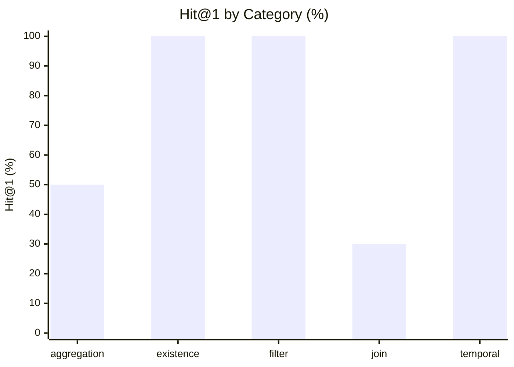

# Northwind Data Discovery Benchmark — Results

**Conditions:** `keyword`  
**Queries:** 20 analytical discovery questions  
**Last run:** 2026-08-08 05:42 UTC

---

## Overall retrieval quality

| Metric | keyword |
|--------|---------|
| Hit@1 | 60% |
| Hit@3 | 60% |
| Hit@5 | 90% |
| MRR | 68% |

```
Hit@5 (% of 20 questions with a relevant result in top 5)

  keyword     ██████████████░   90%
```

---

## Results by category



| Category | n | keyword Hit@1 | keyword MRR |
|---|---|---|---|
| aggregation | 2 | 50% | 0.62 |
| existence | 2 | 100% | 1.00 |
| filter | 4 | 100% | 1.00 |
| join | 10 | 30% | 0.44 |
| temporal | 2 | 100% | 1.00 |

---

## Per-question results

| ID | Category | Intent | keyword H@1 | keyword MRR | keyword Top-3 |
|---|---|--- |---|---|--- |
| nw_disc_01 | filter | How many products are no longer sold? | ✅ | 1.00 | products, northwind, northwind |
| nw_disc_02 | join | Which supplier provides the most products in our catalo… | ✅ | 1.00 | products, northwind, northwind |
| nw_disc_03 | join | What is the average order value for each destination co… | ❌ | 0.25 | northwind, northwind, public |
| nw_disc_04 | join | Which employee processed the most customer orders? | ❌ | 0.25 | northwind, northwind, public |
| nw_disc_05 | join | What product category generates the most total revenue? | ❌ | 0.20 | northwind, northwind, public |
| nw_disc_06 | existence | Which customers have never placed an order? | ✅ | 1.00 | customers, northwind, northwind |
| nw_disc_07 | aggregation | What is the total shipping cost collected by destinatio… | ❌ | 0.25 | northwind, northwind, public |
| nw_disc_08 | filter | Which products are nearly out of stock? | ✅ | 1.00 | products, northwind, northwind |
| nw_disc_09 | join | What is the total revenue generated by each sales emplo… | ❌ | 0.25 | northwind, northwind, public |
| nw_disc_10 | aggregation | Which country has the largest number of customers? | ✅ | 1.00 | country, country, country |
| nw_disc_11 | join | What is the best-selling product by total quantity orde… | ✅ | 1.00 | quantity, northwind, northwind |
| nw_disc_12 | temporal | How many orders were placed each year? | ✅ | 1.00 | orders, northwind, northwind |
| nw_disc_13 | existence | Which products have never appeared in any order? | ✅ | 1.00 | products, northwind, northwind |
| nw_disc_14 | join | What is the average discount percentage applied per pro… | ✅ | 1.00 | discount, northwind, northwind |
| nw_disc_15 | join | What is the total inventory value for each product cate… | ❌ | 0.10 | northwind, northwind, public |
| nw_disc_16 | join | What is the average product price offered by each suppl… | ❌ | 0.12 | northwind, northwind, public |
| nw_disc_17 | temporal | Which employees were hired most recently? | ✅ | 1.00 | employees, northwind, northwind |
| nw_disc_18 | filter | How many orders include at least one discounted item? | ✅ | 1.00 | orders, northwind, northwind |
| nw_disc_19 | join | Which customer has spent the most money across all thei… | ❌ | 0.25 | northwind, northwind, public |
| nw_disc_20 | filter | What are the top five most expensive products still ava… | ✅ | 1.00 | products, northwind, northwind |
