# Search / Discovery Benchmark — Results

**Conditions:** `keyword`, `hybrid`  
**Queries:** 20  
**Last run:** 2026-08-08 00:20 UTC

> Re-generate: `python3 lib/tests/benchmarks/search_benchmark.py --report`

---

## Overall retrieval quality

| Metric | keyword | hybrid |
|--------|--------|--------|
| Hit@1 | 50% | 65% |
| Hit@3 | 55% | 80% |
| Hit@5 | 60% | 90% |
| MRR | 59% | 73% |

| Metric | Δ keyword → hybrid |
|--------|-------------------|
| Hit@1 | **+0.150** (50% → 65%) |
| Hit@3 | **+0.250** (55% → 80%) |
| Hit@5 | **+0.300** (60% → 90%) |
| MRR | **+0.141** (59% → 73%) |

```
Hit@5 (% of 20 queries with a relevant result in top 5)

  keyword     █████████░░░░░░   60%
  hybrid      ██████████████░   90%
```

---

## Results by category

```mermaid
xychart-beta
    title "Hit@1 by Category (%)"
    x-axis ["attr", "concept", "cross", "exact", "synonym"]
    y-axis "Hit@1 (%)" 0 --> 100
    bar [75, 40, 100, 50, 20]
    bar [50, 40, 100, 75, 80]
```



*First bar = keyword · Second bar = hybrid*

| Category | n | keyword Hit@1 | keyword MRR | hybrid Hit@1 | hybrid MRR |
|---|---|---|---|---|---|
| attribute_level | 4 | 75% | 0.78 | 50% | 0.68 |
| concept | 5 | 40% | 0.47 | 40% | 0.47 |
| cross_entity | 2 | 100% | 1.00 | 100% | 1.00 |
| exact_name | 4 | 50% | 0.66 | 75% | 0.81 |
| synonym | 5 | 20% | 0.34 | 80% | 0.87 |

---

## Per-question results

| ID | Category | Intent | keyword Hit@1 | keyword MRR | keyword Top-3 | hybrid Hit@1 | hybrid MRR | hybrid Top-3 |
|---|---|--- |---|---|--- |---|---|--- |
| srch_01 | exact_name | loan table records | ✅ | 1.00 | loan, finance, finance | ✅ | 1.00 | loan, loan_id, finance |
| srch_02 | exact_name | transaction entries in the database | ❌ | 0.12 | finance, finance, public | ❌ | 0.25 | finance, payments, account |
| srch_03 | exact_name | how frequently is the account statement issued | ✅ | 1.00 | account, account, finance | ✅ | 1.00 | account, account, bank |
| srch_04 | exact_name | district location and region data | ❌ | 0.50 | finance, district, finance | ✅ | 1.00 | district, finance, district_id |
| srch_05 | synonym | customer personal profile | ❌ | 0.17 | finance, finance, public | ✅ | 1.00 | client_id, client, account |
| srch_06 | synonym | money transfer value in a transaction | ❌ | 0.12 | finance, finance, public | ✅ | 1.00 | payments, bank, trans_id |
| srch_07 | synonym | monthly repayment installment | ❌ | 0.25 | finance, finance, public | ✅ | 1.00 | payments, loan, loan_id |
| srch_08 | synonym | cash withdrawal or deposit transaction type | ✅ | 1.00 | type, finance, finance | ✅ | 1.00 | type, bank, payments |
| srch_09 | synonym | geographic region or area of the client | ❌ | 0.17 | client, finance, finance | ❌ | 0.33 | client, client_id, district |
| srch_10 | concept | running total of money remaining in the account | ❌ | 0.11 | account, account, finance | ❌ | 0.00 | account, account, bank |
| srch_11 | concept | whether the loan was repaid or went into default | ✅ | 1.00 | loan, finance, finance | ✅ | 1.00 | loan, loan_id, finance |
| srch_12 | concept | which external bank received the wire transfer | ✅ | 1.00 | bank, finance, finance | ✅ | 1.00 | bank, finance, loan |
| srch_13 | concept | purpose or reason code for a bank transaction | ❌ | 0.11 | bank, finance, finance | ❌ | 0.00 | bank, payments, finance |
| srch_14 | concept | age or birth year of the account holder | ❌ | 0.12 | account, account, finance | ❌ | 0.33 | account, account, birth_date |
| srch_15 | attribute_level | how many months does the loan last | ✅ | 1.00 | loan, finance, finance | ✅ | 1.00 | loan, loan_id, finance |
| srch_16 | attribute_level | date when the loan was approved or granted | ✅ | 1.00 | loan, date, date | ✅ | 1.00 | loan, date, date |
| srch_17 | attribute_level | date when the bank account was opened or created | ✅ | 1.00 | account, date, date | ❌ | 0.50 | bank, date, date |
| srch_18 | attribute_level | unique identifier for a banking transaction record | ❌ | 0.12 | finance, finance, public | ❌ | 0.20 | bank, account_id, account_id |
| srch_19 | cross_entity | accounts that have an associated active loan | ✅ | 1.00 | loan, finance, finance | ✅ | 1.00 | loan, loan_id, public |
| srch_20 | cross_entity | client spending and purchase history | ✅ | 1.00 | client, finance, finance | ✅ | 1.00 | client, finance, account |

---

## What each category tests

### attribute_level

**Attribute precision.** Looking for a specific attribute within an entity, including disambiguation cases (loan.date vs account.date). Tests whether attribute-level records surface above entity-level records.

### concept

**Semantic intent.** Abstract concept that implies a specific column through its meaning, not its name. E.g. 'running balance' → trans.balance (STATE_VARIABLE), 'repaid or defaulted' → loan.status (ENUM A/B/C/D). The hardest category for keyword search; the primary motivation for hybrid.

### cross_entity

**Multi-table intent.** Query intent spans multiple related entities. E.g. 'client spending history' should surface client, account, and trans. Checks whether the relevant entity records from multiple tables all appear in top-10.

### exact_name

**Control.** Query uses the exact table or column name as it appears in the schema. BM25 term overlap should handle these reliably. Both conditions expected correct. Validates that the benchmark is not giving an unfair advantage to either condition.

### synonym

**Term mismatch.** Common English synonym for the actual column/table name. E.g. 'customer' → client, 'installment' → payments, 'region' → district. BM25 has no term overlap and is expected to struggle. Hybrid search uses semantic embeddings to bridge the vocabulary gap.
